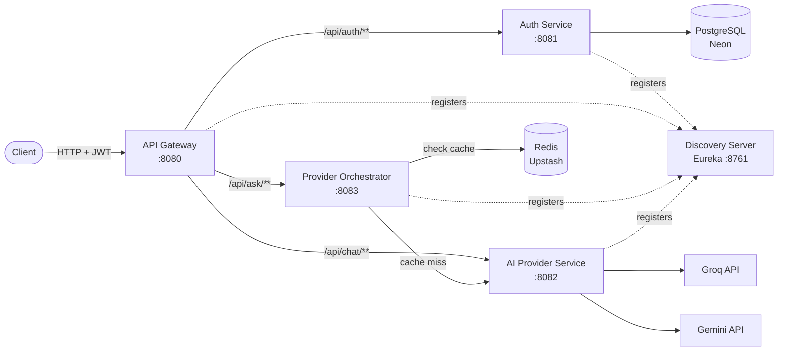

# Multi-AI Gateway Platform

A microservices-based gateway that unifies access to multiple AI providers (Groq, Google Gemini) behind a single authenticated API, with automatic failover, response caching, and centralized service discovery.

Instead of hardcoding a single AI provider into an application, this project routes requests intelligently — trying the fastest provider first and falling back automatically if it fails — while caching repeated prompts to cut latency and API cost.

## Architecture



## Services

| Service | Port | Responsibility |
|---|---|---|
| **discovery-server** | 8761 | Eureka service registry — every other service registers here so they can find each other by name instead of hardcoded URLs |
| **api-gateway** | 8080 | Single entry point for all client traffic; routes requests to the correct backend service by path |
| **auth-service** | 8081 | User registration/login, password hashing (BCrypt), JWT issuance and validation, backed by PostgreSQL |
| **ai-provider-service** | 8082 | JWT-protected adapter layer that calls real AI providers (Groq, Gemini) and normalizes their responses |
| **provider-orchestrator** | 8083 | Decides which provider to use, handles automatic failover (Groq → Gemini), and caches responses in Redis |

## Tech Stack

- **Backend:** Java 17, Spring Boot 3.3
- **Service Discovery:** Netflix Eureka
- **API Gateway:** Spring Cloud Gateway (WebMVC)
- **Security:** Spring Security, JWT (jjwt)
- **Database:** PostgreSQL (hosted on Neon)
- **Cache:** Redis (hosted on Upstash)
- **AI Providers:** Groq (Llama/GPT-OSS models), Google Gemini
- **Build:** Maven (independent projects, no multi-module parent)

## How Routing & Failover Works

1. Client sends a prompt to the gateway with a JWT: `POST /api/ask`
2. Gateway routes it to `provider-orchestrator`
3. Orchestrator hashes the prompt and checks Redis for a cached response
   - **Cache hit** → returns immediately, `servedBy: "cache"`
4. **Cache miss** → orchestrator calls `ai-provider-service`, asking for Groq first
   - **Groq succeeds** → response returned, `servedBy: "groq"`, and cached for future identical prompts
   - **Groq fails** (timeout, model error, rate limit) → orchestrator automatically retries with Gemini, `servedBy: "gemini (fallback, groq failed)"`
   - **Both fail** → a clear error is returned instead of a raw exception, `servedBy: "none"`
5. Redis failures are handled fail-open — if the cache is unreachable, requests still succeed, just without the speed boost, rather than breaking the user-facing request

## Getting Started

### Prerequisites
- Java 17+
- Maven 3.8+
- A PostgreSQL database (e.g., free tier on [Neon](https://neon.com))
- A Redis database (e.g., free tier on [Upstash](https://upstash.com))
- Free API keys from [Groq](https://console.groq.com) and [Google AI Studio](https://aistudio.google.com)

### Environment Variables

Each service reads secrets from environment variables — nothing sensitive is hardcoded in the repo.

**auth-service**
| Variable | Description |
|---|---|
| `DB_USERNAME` | PostgreSQL username |
| `DB_PASSWORD` | PostgreSQL password |
| `JWT_SECRET` | Signing key for JWTs — must be identical across `auth-service` and `ai-provider-service` |

**ai-provider-service**
| Variable | Description |
|---|---|
| `GEMINI_API_KEY` | Google Gemini API key |
| `GROQ_API_KEY` | Groq API key |
| `JWT_SECRET` | Same value as in `auth-service` |

**provider-orchestrator**
| Variable | Description |
|---|---|
| `REDIS_HOST` | Upstash Redis hostname (no scheme, no password) |
| `REDIS_PASSWORD` | Upstash Redis password |

### Running Locally

Start each service **in this order**, waiting a few seconds between each so it can register with Eureka before the next one starts:

```bash
# 1. Discovery server
cd discovery-server && mvn spring-boot:run

# 2. Auth service
cd auth-service && mvn spring-boot:run

# 3. AI provider service
cd ai-provider-service && mvn spring-boot:run

# 4. Provider orchestrator
cd provider-orchestrator && mvn spring-boot:run

# 5. API gateway
cd api-gateway && mvn spring-boot:run
```

Verify all five are registered at the Eureka dashboard: `http://localhost:8761`

### Example Usage

**Register a user:**
```bash
curl -X POST http://localhost:8080/api/auth/register \
  -H "Content-Type: application/json" \
  -d '{"email":"you@example.com","password":"yourpassword"}'
```

**Ask the AI gateway (auto-routed, cached, with failover):**
```bash
curl -X POST http://localhost:8080/api/ask \
  -H "Content-Type: application/json" \
  -H "Authorization: Bearer <TOKEN_FROM_REGISTER_RESPONSE>" \
  -d '{"prompt":"Explain microservices in two sentences"}'
```

Send the same prompt twice — the second response comes from Redis, with a noticeably lower `latencyMs`.

## Challenges Solved

A few non-trivial issues came up building this, worth noting since they reflect real distributed-systems debugging rather than just following a tutorial:

- **`@LoadBalanced` bean hijacking Eureka's internal client:** registering a single `RestClient.Builder` bean marked `@LoadBalanced` caused Eureka's own heartbeat mechanism to use it too, making Eureka try to treat `localhost` as a discoverable service name. Fixed by providing a separate `@Primary` plain `RestClient.Builder` alongside a `@Qualifier`-scoped load-balanced one, so each consumer gets the right instance.
- **JWT secret mismatch across services:** `auth-service` and `ai-provider-service` need to share the exact same signing key to trust each other's tokens. A silent mismatch (two different auto-generated values) caused every authenticated request to fail with 403 despite valid tokens — resolved by centralizing the secret as a single environment variable value applied identically to both.
- **Fail-open caching:** the Redis cache layer is wrapped so that any connectivity failure (bad host, DNS issues, auth failure) degrades gracefully to a cache miss rather than breaking the user-facing request — a deliberate resilience decision, not an accident.
- **Provider deprecation handling:** both Gemini and Groq deprecated their initial model names mid-development, surfaced as 404/400 errors from the live API — a good reminder that AI provider integrations need to tolerate model rotation, not hardcode assumptions.

## Roadmap

- [x] Service discovery (Eureka)
- [x] API Gateway with dynamic routing
- [x] JWT authentication shared across services
- [x] Multi-provider AI integration (Groq + Gemini)
- [x] Automatic failover between providers
- [x] Redis response caching
- [ ] Kafka-based async usage tracking (tokens/requests per user)
- [ ] Per-user rate limiting
- [ ] React frontend (chat UI + usage dashboard)
- [ ] Docker Compose + cloud deployment

## Author

Built by Vaibhav — [GitHub](https://github.com/Vaibhav865)
